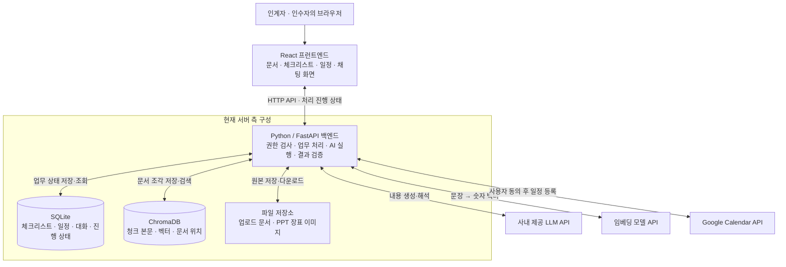
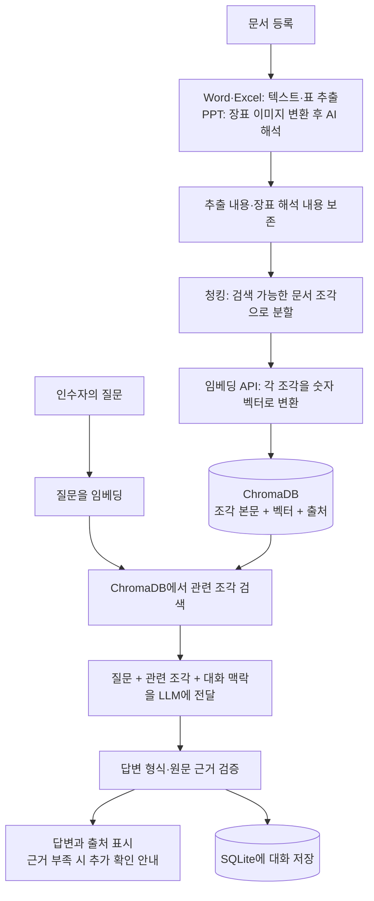
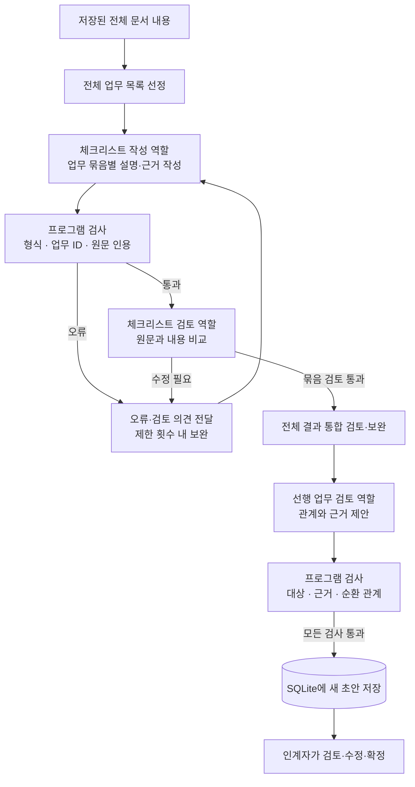

# 시스템과 에이전트 아키텍처 이해하기

코드 확인일: 2026-10-29. 현재 구현 기준이며 운영 배포가 완료되었다는 뜻은 아니다.

## 1. 시스템 아키텍처: 무엇이 어디에 연결되는가

| 구성요소 | 우리 프로젝트에서 하는 일 | 이해하기 쉬운 설명 |
|---|---|---|
| React | 문서 등록, 체크리스트 검토, 월간 달력, 질문 채팅 등의 화면 | 사용자가 보고 누르는 화면 |
| FastAPI | 요청 수신, 권한 확인, DB 조회·저장, AI 호출과 검증 | 화면 뒤에서 실제 업무를 처리하는 서버 프로그램 |
| SQLite | 인수인계 정보, 문서 정보·분석 상태, 체크리스트, 일정, 진행 상태, 대화·질문·답변 등 저장 | 서비스의 현재 상태를 보관하는 업무 기록장 |
| ChromaDB | 문서 조각과 임베딩 벡터, 출처 정보를 저장하고 관련 문서 검색 | 필요한 문서 내용을 의미로 찾는 검색 저장소 |
| 파일 저장소 | 업로드 원본과 PPT 장표 이미지 보관 | 원본 파일 보관함 |
| LLM API | PPT 해석, 체크리스트 작성·검토, 관계·일정 제안, 질문 답변 | 내용을 해석하고 결과를 작성하는 외부 AI |
| 임베딩 API | 문서 조각과 검색 질문을 숫자 벡터로 변환 | 의미 검색을 가능하게 하는 변환기 |
| LangGraph | 일부 AI 처리의 단계·분기·재작성 흐름 제어 | AI 업무의 진행 순서를 관리하는 도구 |
| Pydantic 및 별도 검증 코드 | 응답 형식, 문서 근거, 관계, 작업 대상 등을 검사 | 결과를 저장·실행하기 전에 확인하는 검사 장치 |

React가 DB나 사내 LLM에 직접 접근하는 구조가 아니다. FastAPI가 중간에서 필요한 데이터와 AI 호출을 관리한다. Google 연결 때에는 브라우저가 Google 로그인·동의 화면으로 이동하는 별도 절차가 있다.

SQLite는 RDBMS이지만 별도 DB 서버를 실행하지 않고 파일을 사용한다. 현재 인수인계별 상태를 handovers 테이블의 payload에 JSON으로 묶어 저장한다. 체크리스트·일정마다 정규화된 별도 테이블이 있는 구조는 아니다. 기본 파일은 data/handover.sqlite3이다.

ChromaDB도 현재 별도 원격 서버가 아니라 백엔드에서 PersistentClient로 접근하는 로컬 저장 방식이며 기본 경로는 data/chroma다. SQLite와 ChromaDB를 직접 연결하지 않고 백엔드가 문서·청크 식별자로 자료를 연결한다.

## 2. 문서 등록에서 질문 답변까지

예: '급여 전달 전에 무엇을 확인해야 하나요?'라고 질문하면 관련 문서 조각을 검색한 뒤, 그 내용을 LLM에 제공하여 답변을 만든다. 이것이 우리 서비스의 대표적인 RAG 흐름이다. 임베딩 벡터가 답변을 작성하는 것이 아니라 관련 조각을 찾고, LLM이 해당 조각의 본문을 읽어 답한다.

체크리스트 생성은 질문 Q&A와 다르다. 업무 누락을 줄이기 위해 저장된 전체 문서 청크를 전달한다. 모든 AI 기능이 질문에 맞는 일부 문서만 검색하는 RAG 방식은 아니다.

## 3. 에이전트 아키텍처: AI 역할을 어떻게 나눴는가

역할별 프롬프트·입력·출력을 분리한 6개 AI 역할이 있다. 서로 다른 AI 모델 6개나 독립 서버 6개를 의미하지 않는다. 같은 LLM을 역할에 맞게 여러 번 호출하며, 백엔드가 흐름을 제어한다.

| 역할 | 실행 시점 | 입력과 결과 |
|---|---|---|
| 문서 분석 | 문서 분석 시 | 특히 PPT 이미지를 읽어 장표 전체 내용을 정리. Word·Excel은 프로그램으로 추출한 내용을 보존하며 이 단계에서 LLM 재작성은 하지 않음 |
| 체크리스트 작성 | 초안 생성 시 | 전체 문서 내용을 바탕으로 업무 목록과 항목별 설명·근거 작성 |
| 체크리스트 검토 | 작성 결과 검토 시 | 원문과 초안을 비교하여 누락·중복·조건 오류 등을 지적하고 보완 |
| 선행 업무 검토 | 생성 과정 또는 선행 업무 제안 시 | 항목과 기존 근거를 바탕으로 먼저 필요한 업무와 연결 이유 제안 |
| 일정 계획 | 일정 생성·재조정 시 | 확정 체크리스트와 관계 등을 바탕으로 업무 순서·이유 제안. 날짜 배분은 프로그램이 처리 |
| 업무 Q&A | 인수자 질문 시 | 관련 문서와 대화 맥락으로 답변·출처 또는 확인이 필요한 작업 제안 생성 |

## 4. 핵심인 체크리스트 생성 흐름

각 묶음에도 전체 문서와 전체 업무 목록을 제공한다. 업무 2개씩 작성하며 최대 2개 묶음을 동시에 실행한다. 계속 실패하면 무한 반복하지 않고 종료하며 기존 초안을 유지한다.

작성→형식 검사→AI 검토→보완 분기는 LangGraph로 구성한다. 전체 목록 선정, 묶음 분배, 통합 검토, 선행 관계 제안과 최종 저장은 Python 서버 코드가 연결한다. 모든 기능을 하나의 거대한 LangGraph로 구성한 것은 아니다. Q&A는 검색→답변의 별도 그래프이며 일부 역할은 단일 노드 그래프로 실행된다.

AI 검토는 내용 판단이고 Pydantic 등 프로그램 검사는 형식·존재·규칙 검사다. 두 검사를 구분하며, 어느 쪽도 실제 업무 내용이 무조건 정확하다는 보장은 아니다. 사람이 최종 확정한다.

## 5. 실제 서비스 흐름과 운영 배포의 차이

현재는 React 개발 서버와 FastAPI 서버를 따로 실행하는 로컬 PoC다. '하나의 서버에 여러 사용자 접속'은 사용자마다 프로그램을 설치하는 대신 같은 서비스 주소로 접속하게 한다는 뜻이다. 논리적으로 프런트엔드·백엔드·저장소의 역할은 나뉜다.

SQLite와 ChromaDB 파일은 현재 서버 컴퓨터에 저장된다. 사용자 로그인은 데모 계정 전환 방식이며 운영용 인증은 별도 준비가 필요하다. 세션과 Google 사용자 토큰은 서버 메모리에 있어 재시작하면 다시 로그인·연결해야 한다. 영속 작업 큐나 재시작 후 AI 작업 복구도 현재 구조에 포함되지 않는다.

## 6. 멘토에게 설명할 때

프런트엔드는 React, 백엔드는 Python FastAPI로 구성했습니다. 백엔드가 권한 확인과 업무 처리를 담당하며 두 저장소를 사용합니다. SQLite에는 체크리스트·일정·대화 같은 업무 상태를 저장하고, ChromaDB에는 문서 청크와 임베딩 벡터를 저장합니다. 원본 문서와 PPT 이미지는 파일로 보관합니다.

문서 기반 질문은 ChromaDB에서 관련 내용을 검색해 LLM에 전달하는 RAG 방식입니다. 체크리스트는 누락을 줄이기 위해 전체 문서 내용을 사용합니다. AI 역할은 문서 분석·체크리스트 작성·검토·선행 업무 검토·일정 계획·Q&A로 분리했고, LangGraph와 Python 코드로 실행 순서와 재시도를 제어합니다. AI 결과는 프로그램으로 검증한 뒤 저장하고 인계자가 최종 검토·확정합니다.

## 코드 위치

- 프런트엔드 진입: src/App.jsx
- API·SQLite·작성/검토 그래프: backend/app.py
- 문서 준비·임베딩·ChromaDB: backend/rag.py
- 문서 추출·장표 변환: backend/documents.py, backend/slides.py
- 묶음 작성·통합 검토: backend/checklist_generation.py
- 공통 역할 호출: backend/agents.py
- 선행 업무: backend/dependencies.py
- 일정 계획·배치: backend/scheduling.py
- 질문 검색·답변 그래프: backend/knowledge.py
- 사용자 작업·대화 관리: backend/features.py
- Google OAuth·Calendar: backend/calendar_api.py
