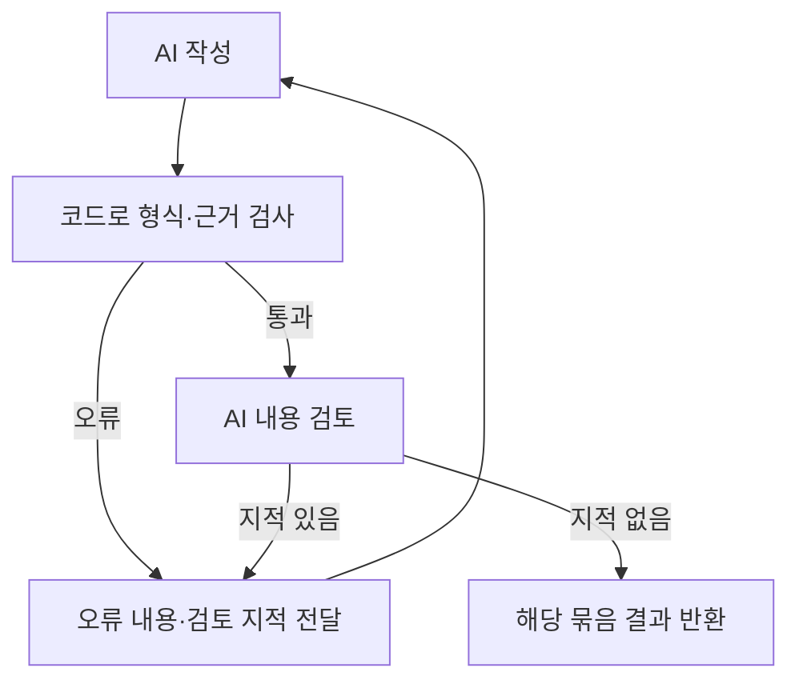

# 업무 인수인계 Agent — 예상 질문과 답변 준비

- 작성일: 2026-10-26
- 용도: AI Master 과제 발표·기술 면접 준비
- 기준: 현재 코드와 확인된 실행 기록. 아래 답변은 연습용 초안이며 본인이 실제로 이해하고 수행한 범위에 맞춰 사용한다.
- 작성 원칙: 구현 사실, 검증 결과, 향후 계획을 구분한다. AI 개발 도구의 작업을 혼자 수행한 것으로 설명하지 않는다.


## 1. 먼저 준비할 질문

### Q1. 어떤 문제를 해결하는 서비스인가요?

답변 초안: 기존 업무 문서가 있어도 인수인계할 항목을 다시 정리하고 반복 질문에 답해야 하는 부담이 있습니다. 업무에 사용하던 문서를 등록하면 체크리스트 초안을 만들고 인계자가 검토·확정합니다. 이후 일정과 수행 상태를 관리하고 인수자는 문서 근거 채팅으로 질문할 수 있습니다. 근거가 부족한 부분은 인계자의 추가 답변으로 연결합니다.

꼬리 질문: 문서 요약 서비스와 무엇이 다른가요?

답변 포인트: 요약문 제공에서 끝나지 않고 확인 가능한 업무 항목·근거·선행 관계·일정·수행 상태로 연결한다. 원본부터 인수인계용으로 새로 작성해야 하는 서비스가 아니다.


### Q2. 왜 AI가 필요한가요? 일반 프로그램으로 만들면 안 되나요?

답변 초안: 문서마다 형식과 표현이 달라 어떤 내용이 하나의 인수 업무인지, 어떤 준비 조건이 다음 업무에 필요한지 고정 규칙만으로 판단하기 어렵습니다. 그 해석은 AI에 맡기고, 권한·ID·원문 인용 일치·관계 순환·일정 조건처럼 명확하게 검사할 수 있는 부분은 프로그램이 처리합니다.

꼬리 질문: AI가 날짜까지 직접 정하나요?

답변 포인트: AI는 업무 순서와 이유를 제안한다. 날짜는 프로그램이 남은 배치 가능일과 선후관계를 적용해 배정한다.


### Q3. 실제로 멀티 에이전트인가요? 프롬프트만 여러 개인 것 아닌가요?

답변 초안: 문서 분석, 체크리스트 작성, 내용 검토, 선행 업무 검토, 일정 계획, 업무 Q&A의 여섯 역할로 나눴습니다. 역할별 입력·출력과 판단 기준을 분리하고 작성 결과에 검토 피드백을 돌려주는 워크플로우입니다. 모든 Agent가 자율적으로 협상하거나 전체 서비스가 하나의 LangGraph에 들어간 구조는 아닙니다. LangGraph와 서버의 순서·병렬 실행 제어를 함께 사용한 역할 분리형 구조입니다.

꼬리 질문: 하나의 큰 프롬프트보다 낫다는 것을 증명했나요?

답변 포인트: 역할별 오류 추적과 부분 재작성 이점은 설명할 수 있다. 동일 평가셋으로 단일 호출과 비교한 품질 우위는 아직 측정하지 않았다. 호출 수·지연 증가가 비용이다.

확인할 코드: backend/agents.py, backend/app.py, backend/checklist_generation.py, backend/dependencies.py


### Q4. 같은 모델이 작성과 검토를 하면 같은 오류를 반복하지 않나요?

답변 초안: 그 가능성이 있습니다. 검토 호출에는 초안과 전체 원문을 별도로 주고 누락·중복·정책 혼동을 찾도록 기준을 나눴습니다. 하지만 같은 모델의 검토를 독립적인 정답 판정으로 보지는 않습니다. 프로그램의 원문 검증과 인계자의 최종 검토를 함께 두었습니다.

꼬리 질문: 원문 인용이 맞으면 내용도 맞는 것 아닌가요?

답변 포인트: 인용이 실제로 존재하는 것과 그 인용이 주장을 뒷받침하는 것은 다르다. 존재 검증은 프로그램이, 의미 검토는 AI와 사람이 수행한다.


### Q5. 체크리스트 생성도 RAG인가요? 왜 전체 문서를 보내나요?

답변 초안: 문서를 청크·임베딩으로 관리하지만 체크리스트 작성에는 상위 검색 결과만 사용하지 않고 저장된 전체 내용을 제공합니다. 사용자가 특정 질문을 한 것이 아니라 문서 전체의 인수 업무를 찾아야 하므로 일부만 검색하면 업무를 놓칠 수 있기 때문입니다. 질문 답변에는 질문 관련 청크를 검색하는 RAG를 사용합니다.

꼬리 질문: 문서가 많아지면 어떻게 하나요?

답변 포인트: 현재 PoC는 문서 수와 텍스트·장표 한도를 둔다. 전체 자료 반복 전달은 토큰·지연 측면에서 한계가 있다. 대규모 환경의 문서 계층화·누락 점검 방식은 향후 검증 대상이며 구현된 것처럼 말하지 않는다.

확인할 코드: backend/rag.py, backend/knowledge.py, backend/checklist_generation.py


### Q6. 요청을 나누면 문서 사이의 맥락이 끊기지 않나요?

답변 초안: 입력 문서를 나누는 대신 작성할 결과를 두 업무씩 나눴습니다. 각 요청에 전체 문서와 전체 업무 목록을 함께 전달하고 마지막에 전체 결과를 통합 검토합니다. 따라서 문서별로 따로 생성한 뒤 단순 합치는 방식과 다릅니다. 대신 입력 토큰을 반복 사용하고 통합 검토도 필요합니다.

확인할 테스트: backend/test_checklist_generation.py의 전체 근거·업무 목록 유지 검사


### Q7. 가장 어려웠던 오류와 해결 방법은 무엇인가요?

답변 초안: 체크리스트를 길게 생성할 때 HTTP 502 또는 출력 잘림으로 실패하는 문제가 있었습니다. 대기 시간만 늘리는 대신 전체 업무 목록 선정, 소수 항목 작성, 전체 통합 검토로 나눴습니다. 출력 종료 사유를 확인하고 실패한 묶음만 더 작게 재작성하며, 모든 검증을 통과하기 전에는 기존 결과를 덮어쓰지 않도록 했습니다.

꼬리 질문: 502의 정확한 원인은 무엇이었나요?

답변 포인트: 상위 서비스 내부 원인까지 확인하지는 못했다. 관찰한 상태 코드·응답 종료 사유와 적용한 대응을 구분한다. 출력 잘림과 게이트웨이 오류를 같은 원인으로 단정하지 않는다.

확인할 코드: backend/ai_transport.py, backend/checklist_generation.py


### Q8. 선행 업무는 어떻게 판단하고 검증하나요?

답변 초안: 문서에 권한·환경·준비 결과처럼 후속 업무를 진행하기 위한 조건이 있는지 확인합니다. 문서에 먼저 나오거나 중요하다는 이유로 연결하지 않습니다. AI는 기존 인용의 참조 ID를 선택하고 서버가 그 원문을 연결합니다. 존재하지 않는 업무나 근거, 자기 참조·중복·순환은 거부하고 인계자가 최종 수정·확정합니다.

꼬리 질문: 관계가 하나도 없으면 실패인가요?

답변 포인트: 명확한 조건이 없으면 빈 결과도 정상이다. 관계 개수를 늘리는 것이 목표가 아니다. 문서에 필요한 정보가 없으면 실제 필요한 관계도 찾지 못할 수 있다.

확인할 코드: backend/dependencies.py


### Q9. AI가 제목을 조금 바꿨다고 실패한 문제는 어떻게 해결했나요?

답변 초안: 응답을 제목 문자열로 연결하면 표현 차이 때문에 같은 업무를 다른 것으로 판단할 수 있습니다. 요청별 target_id를 부여하고 응답의 ID를 검증한 뒤 서버가 원래 제목과 순서를 적용하도록 바꿨습니다. 누락·중복·알 수 없는 ID는 거부하며 비슷한 제목을 추측해서 연결하지 않습니다.

확인할 코드·테스트: backend/checklist_generation.py, backend/test_checklist_generation.py


### Q10. 실제로 어떤 결과를 검증했나요?

답변 초안: 직접 만든 인사 문서 7개와 개발 문서 7개로 실제 모델 생성 API를 실행했습니다. 저장된 성공 실행은 인사 34항목·선행 관계 3개, 개발 25항목·선행 관계 6개입니다. 생성 이후 저장·재조회와 근거·관계 검증을 확인했고 원본 데이터는 바꾸지 않았습니다. 이 결과는 업무 완전성이나 현장 효과 전체를 입증한 것은 아닙니다.

꼬리 질문: 얼마나 빨라졌나요? 정확도는 몇 퍼센트인가요?

답변 포인트: 성공 실행 시간은 각각 약 247.4초·296.3초다. 단일 실행 관측값이며 평균이나 SLA가 아니다. 기존 방식 대비 시간 절감률·정답률은 아직 실측 결과로 제시할 수 없다. 이전 실패 실행도 있었으므로 성공률 100%라고 말하지 않는다.

증빙: .artifact-build/hr-dev-regression-de5188d0c0/summary.json, .artifact-build/hr-dev-regression-6a4eb415d9/summary.json


## 2. 깊이 있는 질문

### Q11. 예시 문서를 선행 관계가 나오도록 고쳤다면 테스트가 유리하게 만들어진 것 아닌가요?

답변 초안: 선행 조건을 포함한 양성 사례를 의도적으로 만든 것은 맞습니다. 따라서 그 결과로 일반 문서 전체에서의 성능을 주장하면 안 됩니다. 조건이 없는 문서, 일반 운영 절차만 있는 문서, 모호하거나 상충하는 문서도 별도로 평가해야 합니다. 원문을 바꿔 정답을 유도한 테스트와 독립 평가셋의 성능은 구분하겠습니다.

추가 준비: 프롬프트 수정에 쓰지 않은 문서를 별도로 보관하고 예상 업무·관계를 생성 전에 정한다. 관계 없음·잘못된 관계 제안도 함께 평가한다. 제품 기능 추가가 아닌 평가 보완이다.


### Q12. PPT 전체 내용을 정말 다 읽을 수 있나요?

답변 초안: 이미지를 보내 본문·표·그래프·주석을 정리하고 추출 텍스트와 발표자 노트도 함께 보존하지만 모든 내용을 완벽하게 읽는다고 보장할 수 없습니다. 흐릿한 글씨나 복잡한 차트는 판독 제한을 표시하고 장표를 사람이 확인하도록 했습니다. Word·Excel의 이미지·차트 등은 별도의 추출 제한도 있습니다.

꼬리 질문: 텍스트 추출과 이미지 분석 중 무엇을 선택하나요?

답변 포인트: Word·Excel은 추출·보존을 기본으로 하고 PPT는 시각 정보 때문에 이미지 해석을 추가한다. 전체 내용 보존을 목표로 하지만 실제 완전성을 보장한다고 말하지 않는다.


### Q13. 청킹 크기와 임베딩 모델은 왜 그렇게 정했나요?

답변 초안: 기본 1,200자·중첩 160자로 구성해 긴 문서를 나누고 경계에서 내용이 끊기는 것을 줄이려 했습니다. 임베딩은 text-embedding-3-large를 사용합니다. 다만 이 조합이 최적이라는 비교 평가를 완료한 것은 아닙니다. 향후 고정 질문과 정답 근거로 검색 누락·관련 없는 검색 결과를 비교해야 합니다.

추가 설명: Q&A는 문서별 최대 6개 후보에서 거리 기준을 적용한 뒤 전체 최대 12개를 사용한다. 거리값을 정답 확률로 해석하지 않는다. 현재 검색 코드에 별도 LLM 재순위화가 있는 것처럼 설명하지 않는다.


### Q14. 일정 균등 배치가 실제 업무량을 반영하나요?

답변 초안: 현재는 업무별 실제 소요 시간을 추정하지 않고 항목 수를 기준으로 날짜에 나눕니다. AI는 중요도와 선행 조건을 고려한 순서를 제안하고 프로그램이 날짜를 정합니다. 이해하기 쉬운 초안을 제공하기 위한 선택이며 항목마다 난이도가 다르므로 실제 업무량까지 균등하다는 뜻은 아닙니다. 인계자가 달력에서 조정합니다.

꼬리 질문: 같은 날 선행·후속 업무가 있으면 어떻게 하나요?

답변 포인트: 후속 업무가 더 이른 날짜에 배치되지 않도록 검사하고 같은 날이면 선행 업무부터 진행하도록 안내한다. 시간 단위 충돌을 최적화한 일정은 아니다.


### Q15. 사용자가 AI 결과를 기다리는 동안 다른 화면으로 가면 어떻게 되나요?

답변 초안: 같은 인수인계 작업 공간의 메뉴를 이동해도 상위 상태에서 진행 정보를 유지합니다. 다만 화면 이동을 지원하는 것과 서버 작업의 영속 복구는 다릅니다. 브라우저 종료·서버 재시작 이후 자동 복구를 보장하는 작업 큐는 구현하지 않았습니다.


### Q16. 개인정보와 접근 권한은 어떻게 보호하나요?

답변 초안: 상세 자료 접근과 변경 시 서버에서 지정된 참여자인지와 역할을 검사하고 문서·검색 범위를 인수인계별로 제한합니다. API 키는 환경 설정으로 분리하며 Git에서 제외합니다. 그러나 현재 사용자 선택은 PoC용이라 운영 인증 체계가 아닙니다. 실제 회사 문서를 쓰려면 SSO·보관 정책·모델 전송 정책 등을 별도 확인해야 합니다.

꼬리 질문: 문서에 악성 명령이 있으면요?

답변 포인트: 문서를 지시가 아닌 데이터로 취급하도록 프롬프트에 명시하고 서버 권한·작업 확인을 별도로 강제한다. 이것만으로 프롬프트 인젝션이 완전히 해결됐다고 주장하지 않는다.


### Q17. Google 연결은 사용자마다 API 키를 받아야 하나요?

답변 초안: 서비스의 OAuth 클라이언트 설정은 공통으로 두고 사용자가 개인 계정으로 로그인해 권한에 동의합니다. 확정 일정을 등록하며 동일 항목 재등록은 기존 이벤트를 갱신합니다. 현재 토큰은 서버 메모리에 있어 재시작하면 재연결이 필요합니다. 실제 계정 등록·갱신 검증과 양방향 동기화 구현 여부는 별도로 구분해야 합니다.

한계: 체크리스트 재생성으로 항목 ID가 바뀐 뒤 이전 Google 이벤트를 자동 정리하는 기능은 완료로 설명하지 않는다.


### Q18. KPI의 기준선은 어디에서 나온 수치인가요?

답변 초안: 작성 120분·인수인계 10업무일·직접 문의 20건·기한 내 완료율 70%는 기획상 예상값입니다. 실제 회사 평균이 아닙니다. 50% 단축 등은 목표이며 직접 기록한 수작업 기준선과 비교해야 합니다. 혼자 역할을 나누어 평가하는 모의 결과를 현장 효율 개선으로 일반화하지 않겠습니다.

추가 준비: 문서·완료 기준·질문셋을 고정하고 생성 대기·사람 검토·수정을 모두 시간에 포함한다. 완료율은 개별 체크리스트가 아니라 인수인계 사례 단위로 판단한다.


## 3. 본인 기여와 성장

### Q19. AI 개발 도구를 많이 썼는데 본인이 한 일은 무엇인가요?

답변 초안: 코드 작성에는 AI 개발 도구를 활용했습니다. 제가 결정하고 검토한 부분은 기존 업무 문서를 입력으로 쓰는 방향, 문서 내용을 요약으로 잃지 않도록 하는 요구, 근거가 무엇인지 분명하게 보여주는 화면, 체크리스트 검토 단계에서 선행 관계를 확인하는 흐름, 항목 수 기반 일정 배분 등입니다. 실제 사용 화면과 생성 결과를 확인하며 문제를 제기하고 수정 방향을 정했습니다. 코드 수준에서 직접 분석·수정한 부분은 제가 설명할 수 있는 사례만 구체적으로 말씀드리겠습니다.

확인 필요: 이 답변은 대화에서 확인된 요구·검토 기여를 바탕으로 한 초안이다. 특정 함수의 구현이나 오류 원인 발견을 본인이 직접 했다고 추가하려면 실제 사례를 확인한다.

준비할 증거: 본인이 제기한 문제 1개, 수정 전후 화면/출력, 관련 함수 흐름, 왜 그 수정이 필요한지, 확인한 테스트와 한계.


### Q20. 다시 만든다면 무엇부터 개선하겠나요?

답변 초안: 기능을 더 늘리기보다 체크리스트 품질을 비교할 독립 평가셋을 먼저 만들겠습니다. 필수 업무 포함 여부, 근거가 설명을 뒷받침하는지, 불필요한 업무 분리와 잘못된 선행 관계를 함께 보겠습니다. 그 결과를 바탕으로 호출 횟수와 전체 문서 반복 전달을 줄일 수 있는지 검토하겠습니다. 실제 배포를 한다면 인증과 장기 작업 복구도 별도로 준비해야 합니다.


## 4. 연습 순서와 갱신 방법

1. Q1·Q2: 30초 안에 서비스와 AI 필요성을 설명한다.
2. Q3·Q5·Q6: 실제 데이터 흐름을 보며 역할 분리와 RAG 사용 범위를 설명한다.
3. Q7·Q8·Q9: 오류 하나를 문제 → 조사 → 변경 → 검증 → 남은 한계 순서로 설명한다.
4. Q10·Q11·Q18: 성공 기록과 평가 한계를 구분해 답한다.
5. Q19: 본인 기여 사례와 직접 설명할 코드를 정한다.

새 오류를 해결하거나 설계를 바꾸면 관련 질문 아래에 이유·증빙·한계를 추가한다. 기능을 구현했다는 이유만으로 성과 수치를 갱신하지 않는다.

대답하지 못한 꼬리 질문은 별도로 기록하고 코드를 확인한 뒤 답변을 보완한다. 문구를 외우기보다 자신의 말로 설명할 수 있는지를 확인한다.

## 5. 함께 볼 자료

- [Task 4 — 역할과 처리 구조](TASK_04_SUBMISSION.md)
- [구현 상태와 검증 기록](IMPLEMENTATION.md)
- [Task 2 — 문제·KPI·평가 조건](TASK_02_SUBMISSION.md)


## 6. 직접 물어본 질문과 이해 기록

사용자가 궁금해서 질문한 내용도 이 절에 질문·쉬운 설명·실제 구현 근거로 누적한다. 면접 답변 초안과 구분하고 확인하지 않은 내용을 사실로 적지 않는다.

### 2026-10-26 — DB도 사용하고 있나요?

사용한다. 업무 상태를 저장하는 SQLite와 문서 의미 검색을 위한 ChromaDB를 함께 사용한다. 둘 다 로컬에 저장하며 별도의 외부 DB 서버를 운영하는 구조는 아니다.

| 저장 방식 | 저장 내용 | 역할 |
|---|---|---|
| SQLite | 인수인계 기본 정보·참여자 연결, 문서 정보와 추출 결과, 체크리스트·검토 상태, 일정·수행 상태, 대화·추가 질문·답변, 서명 기록 등 | 사용자가 입력하거나 확정한 업무 상태를 저장하고 다시 조회 |
| ChromaDB | 문서 청크, 임베딩 벡터, 문서·청크 위치 등의 메타데이터 | 질문과 의미가 가까운 문서 내용을 검색 |
| 파일 저장소 | 업로드한 Word·Excel·PPT 원본과 변환한 장표 이미지 등 | 원본 다운로드와 장표 확인 |

예: 체크리스트의 검토 완료 상태를 저장하는 곳은 SQLite이고, 질문에 답할 문서 구절을 찾는 곳은 ChromaDB다. 원본 파일은 별도 파일로 보관한다.

SQLite는 별도 서버 설치 없이 파일로 사용하는 관계형 DB다. 다만 현재 앱은 업무별 테이블을 세밀하게 나누기보다 handovers 테이블에 인수인계 ID와 JSON 형태의 전체 상태(payload)를 저장한다. SQLite를 사용한다는 것과 현재 데이터 모델이 정규화되어 있다는 것은 다르다.

기본 SQLite 경로는 data/handover.sqlite3이며 HANDOVER_DB 설정으로 변경할 수 있다. 벡터 저장소는 data/chroma를 사용한다. 사용자 세션과 Google 연결 토큰은 별도 서버 메모리 상태이므로 DB 자료처럼 재시작 후 자동 유지되는 것은 아니다.

구현 확인: backend/app.py의 DB·ensure_storage·read_state·write_state, backend/rag.py의 collection.

면접용 짧은 답변: 업무 데이터와 대화는 SQLite에, 문서 검색용 청크와 벡터는 ChromaDB에 저장합니다. 원본 파일은 파일 저장소로 분리했습니다. PoC에서는 로컬 파일 기반으로 구성했고, 여러 사용자가 동시에 쓰는 운영 환경에서는 데이터 모델과 동시 쓰기 처리를 추가 검토해야 합니다.


### 2026-10-26 — 청킹과 임베딩은 무엇인가요?

청킹은 긴 문서를 검색에 사용할 작은 조각으로 나누는 작업이다. 조각 하나를 청크라고 한다. 요약하거나 내용을 새로 쓰는 작업이 아니다. 예를 들어 운영 매뉴얼을 나누어 권한 신청, 일일 점검, 장애 대응 내용을 더 작은 범위로 검색할 수 있도록 한다. 이 예시는 개념 설명이며 현재 코드가 업무 제목별로 정확히 분리한다는 뜻은 아니다.

현재 텍스트 분할의 기본값은 최대 1,200자이며 가능한 경우 줄바꿈 근처에서 나눈다. 앞뒤 청크는 160자 정도 겹쳐 경계에서 조건이나 설명이 끊기는 문제를 줄인다. 문자 수 기준이지 토큰 수 기준은 아니다. 원본 문서와 위치 정보를 함께 보존한다.

임베딩은 텍스트의 의미적 특징을 여러 숫자로 이루어진 벡터로 표현하는 작업이다. 현재는 text-embedding-3-large로 문서 청크를 변환한다. ChromaDB에는 벡터뿐 아니라 청크 본문과 문서 위치도 함께 저장한다. 벡터 자체가 읽을 수 있는 요약이나 최종 답변은 아니다.

질문도 같은 모델로 임베딩한 뒤 문서 청크의 벡터와 비교한다. 예를 들어 ‘접속 권한은 누구에게 신청하나요?’라는 질문은 ‘시스템 접근 신청은 담당 책임자의 승인을 받는다’는 문서 부분을 검색하는 데 사용할 수 있다. 표현이 달라도 관련 내용을 찾기 위한 방식이며 실제 검색 성공이나 정답을 보장하는 예시는 아니다.

처리 순서: 문서 내용 추출·정리 → 청킹 → 청크 임베딩 → ChromaDB 저장. 질문 시에는 질문 임베딩 → 관련 청크 검색 → 질문과 청크 본문을 LLM에 전달 → 답변 생성·인용 검증 순서다.

주의: 의미가 비슷하게 검색됐다는 사실만으로 답변이 맞는 것은 아니다. 필요한 조건과 예외가 청크에 포함되어 있는지, 인용이 실제 주장을 뒷받침하는지 검증해야 한다. 청크가 너무 작으면 맥락이 끊기고 너무 크면 관련 없는 내용이 섞일 수 있다. 1,200자·160자 설정이 최적이라는 비교 평가를 완료한 것은 아니다.

우리 프로젝트에서는 질문 답변에 관련 청크 검색을 사용하지만 체크리스트 생성에는 업무 누락을 줄이기 위해 저장된 전체 문서 청크를 사용한다. 두 흐름을 혼동하지 않는다.

면접용 짧은 답변: 청킹은 문서를 검색 가능한 작은 조각으로 나누는 것이고, 임베딩은 각 조각의 의미를 숫자 벡터로 표현하는 것입니다. 질문도 같은 방식으로 변환해 관련 문서 조각을 찾고, 그 본문을 LLM에 전달해 근거 있는 답변을 생성합니다.


### 2026-10-26 — 어느 기능에서 DB와 RAG를 사용하나요?

DB는 데이터를 저장·조회하는 수단이고 RAG는 관련 문서를 검색해 생성 모델에 제공하는 처리 방식이다. 서로 대체하는 선택지가 아니며 RAG도 벡터 DB를 사용할 수 있다. 우리 시스템의 대표적인 검색 기반 RAG 기능은 업무 질문 답변이다.

| 기능 | SQLite·파일 사용 | ChromaDB·RAG 사용 |
|---|---|---|
| 인수인계 생성·목록·권한 확인 | 기본 정보·참여자 연결·상태 저장과 조회 | 사용하지 않음 |
| 문서 등록·분석 | 문서 정보·분석 결과 저장, 원본·장표 이미지는 파일 보관 | 청크·임베딩 저장. 질문 RAG를 위한 준비 단계 |
| 체크리스트 생성 | 자료 상태 조회와 최종 초안 저장 | 저장된 전체 문서 청크를 제공. 질문에 맞는 일부 청크를 고르는 검색 방식과 구분 |
| 체크리스트 검토·확정 | 항목·검토·확정 상태 저장 | 수정·확정 자체에는 검색 기반 RAG 불필요. 근거 확인은 연결된 인용·문서 조회 |
| 선행 업무 제안 | 항목과 기존 근거를 읽고 제안 관계 저장 | 기존 인용을 AI에 제공하며 별도 유사도 검색을 수행하지 않음 |
| 일정 생성·재조정 | 확정 항목·선행 관계·기간·수행 상태 조회, 일정 저장 | 문서 검색 없이 업무 순서 제안과 날짜 배치 수행 |
| 현황·진행 상태 변경 | 저장된 상태 조회·갱신, 진행률 계산 | 사용하지 않음 |
| 업무 질문 채팅 | 대화·요약·답변 저장과 조회 | 질문 임베딩 → 관련 청크 검색 → 근거 기반 답변 생성·검증 |
| 인계자 추가 질문·답변 | 원 질문·AI 답변·근거·사람 답변 연결 저장 | 사람 답변 저장 자체는 RAG가 아니며 자동 검색 자료 편입도 하지 않음 |
| 캘린더 등록·문서 출력 | 확정 일정·내용·서명 조회, 등록 결과 기록 또는 파일 생성 | 사용하지 않음 |

예: ‘재처리 전에 어떤 승인이 필요한가요?’에는 ChromaDB에서 관련 문서 조각을 검색해 LLM에 전달하고 답변을 SQLite에 저장한다. 반면 달력에서 업무 날짜를 바꾸는 작업은 저장된 일정 조건을 검사·반영하며 문서 RAG를 사용하지 않는다.

면접용 짧은 답변: 업무 상태와 대화는 SQLite로 관리하고 문서 청크와 벡터는 ChromaDB로 관리합니다. 질문 답변은 관련 문서를 검색하는 RAG를 사용하지만, 체크리스트는 전체 문서 내용을 전달하며 일정은 확정 업무 데이터를 활용합니다. AI를 호출하는 모든 기능이 RAG인 것은 아닙니다.


### 2026-10-28 — Pydantic이 무엇이고 원문 검증과 어떻게 다른가요?

Pydantic은 Python에서 데이터가 정해 놓은 형식과 조건에 맞는지 검사하는 라이브러리다. AI 모델이 아니며 AI가 반환한 데이터를 프로그램에서 사용하기 전에 확인하는 용도로 사용한다.

예를 들어 체크리스트에는 제목·설명·중요도·근거 등이 필요하다. Pydantic 모델에 필수 항목, 자료형, 허용 값과 길이 조건을 정의하면 제목 누락이나 허용하지 않은 중요도 같은 잘못된 데이터를 검출할 수 있다. 구체적으로 무엇을 검사할지는 개발자가 정의한 규칙에 달려 있다.

형식 검사와 원문 대조는 다르다. 문서 ID가 문자열이라는 조건을 만족해도 실제 등록된 문서의 ID인지는 알 수 없다. 따라서 별도 코드로 문서 ID가 존재하는지, 청크 ID가 해당 문서의 조각인지, 인용문을 그 자료에서 확인할 수 있는지 검사한다. 작업 요청도 형식 검사 외에 대상 존재 여부·사용자 권한·실행 확인 등을 별도로 검사한다.

흐름: AI 결과 수신 → Pydantic으로 형식과 조건 검사 → 별도 코드로 실제 자료·업무 규칙 대조 → 통과한 결과만 반영. 보완 가능한 오류는 재요청하고 최종 검증에 실패하면 기존 초안을 덮어쓰지 않는다.

검사의 한계: 실제 원문에 있는 문장을 인용했다고 해서 그 문장이 체크리스트의 주장을 충분히 뒷받침한다는 뜻은 아니다. 형식·존재 확인과 의미의 정확성은 구분하며 AI 통합 검토와 인계자의 최종 검토가 필요하다.

면접용 짧은 답변: Pydantic으로 AI 응답의 필수 항목과 자료형 등을 검사하고, 별도 코드로 문서와 인용 근거가 실제 자료에 존재하는지 대조합니다. 형식이 맞다는 이유만으로 사실까지 맞다고 판단하지 않습니다.


### 2026-10-28 — 일반 사이트도 운영자가 Google OAuth를 설정하나요?

그렇다. Google Calendar에 사용자를 대신해 접근하는 일반적인 서버 기반 웹 서비스는 운영자가 Google에 애플리케이션과 OAuth 클라이언트를 등록하고 서버에 공통 설정을 보관한다. 사용자는 연결 버튼으로 Google 로그인·동의 화면에 이동하고 본인 계정의 접근을 허용한다. 사용자가 클라이언트 ID·Secret을 발급하거나 입력하는 방식이 아니다.

공통 OAuth 클라이언트는 어느 서비스가 접근을 요청하는지 식별하고, 사용자별 토큰은 어느 사용자가 어떤 접근을 허용했는지 나타낸다. 운영자의 개인 캘린더를 모든 사용자가 공유한다는 뜻이 아니다.

다른 PC에서 Git 코드를 내려받아 서버를 실행하는 것은 기존 공용 서버에 접속하는 것과 다르다. 새로운 서버 실행 환경에는 Git에서 제외된 공통 OAuth 설정을 별도로 넣어야 한다. 공용 서버에 배포한 뒤에는 사용자는 서비스 주소로 접속하여 로그인·동의만 하면 된다.

공식 근거: https://developers.google.com/identity/protocols/oauth2/web-server


### 2026-11-02 — 업무 지식 관리 용도로 어느 정도 활용할 수 있나요?

현재는 인수인계별 문서 보관·검색 기반 AI 질문·근거 확인·대화 기록·인계자의 추가 답변을 제공한다. 인수인계 기간 종료만으로 질문을 차단하지 않으므로 자료와 접근 권한, 확정 상태가 유지되면 이후에도 참고할 수 있다. 이는 코드 확인 결과이며 이번에 실제 모델로 재시험한 것은 아니다.

독립적인 팀 지식관리 서비스로 완성된 상태는 아니다. 질문 기능에 체크리스트 확정이 필요하고, 접근과 검색 범위는 해당 인수인계와 두 참여자에 묶여 있다. 인계자의 추가 답변은 저장·조회되지만 RAG 검색 지식으로 자동 편입되지 않는다. 문서 버전별 변경 이력·유효성 관리, 여러 인수인계의 통합 검색, 팀 단위 공유는 별도 보완이 필요하다.

기존 범위에서 우선 검토할 개선 후보는 체크리스트 확정과 문서 Q&A 사용 조건을 분리하는 것이다. 인계자 답변을 검토 후 검색 지식으로 등록하는 기능도 후보이나, 새로운 개발은 사용자와 범위를 합의한 뒤 진행한다.

면접용 짧은 답변: 인수인계 과정에서 모은 문서와 질의응답을 계속 참고할 수 있는 기반은 구현했습니다. 다만 현재는 인수인계별 접근·확정 흐름에 묶여 있으며 팀 전체 지식 저장소와 답변의 재사용까지 완성된 것은 아닙니다.


### 2026-11-04 — 핵심 기술 세 가지를 다른 사람에게 설명하려면?

체크리스트 생성 코드를 기준으로 선정한 세 가지다. React·FastAPI·DB의 이름을 나열하는 대신 AI 결과를 만드는 방법, 검사하는 방법, 실패에 대응하는 방법을 설명한다. 아래 주문 재처리 사례와 6개 업무 목록은 이해를 돕는 축약 예시이며 실제 모델 실행 결과나 측정값이 아니다.

| 핵심 기술 | 맡는 역할 |
|---|---|
| LangGraph 조건부 워크플로우 | 작성·검사·내용 검토를 연결하고 실패하면 수정 요청과 함께 작성 단계로 되돌린다. |
| 구조화 응답과 다층 검증 | 응답 형식, 근거의 실제 존재와 연결, 설명의 의미를 서로 다른 방법으로 확인한다. |
| 전체 문맥 유지와 출력 분할·병렬 처리 | 참고 자료는 모두 주고, 한 번에 작성할 업무만 작게 나눈 뒤 결과를 합쳐 검토한다. |


#### 1. LangGraph: 작업 순서와 조건에 따른 다음 단계 관리

LLM은 내용을 생성하고, LangGraph는 그 결과를 어느 단계로 보낼지 관리한다. LangGraph 자체가 AI 모델은 아니다. 우리 코드에서는 묶음별 작성·검증·검토·수정 흐름에 사용한다. 전체 업무 목록 선정과 병렬 처리, 결과 병합과 통합 검토는 별도 Python 코드에서 관리한다.



Node는 일을 수행하는 단계 또는 함수다. 작성 노드는 LLM을 호출하고, 형식·근거 검사 노드는 일반 Python 코드로 검사한다. 따라서 모든 노드가 하나의 AI인 것은 아니다.

Edge는 단계 사이의 연결이다. 조건부 연결은 검사 결과에 따라 다음 단계를 바꾼다. 검증 오류가 없으면 내용 검토로, 오류가 있으면 수정 요청을 만드는 단계로 간다.

State는 이번 실행에서 단계들이 주고받는 작업 기록이다. 코드에서는 AI 응답, 검사된 결과, 오류 내용, 작성 시도 횟수 등을 전달한다. 장기 대화 기억이나 재시작 복구 저장소와 같은 뜻은 아니다.

예를 들어 원문에 ‘재처리는 서비스 책임자의 승인을 받은 대상 주문만 실행한다’고 있는데 AI가 ‘승인 없이 모든 실패 주문을 즉시 재처리한다’고 썼다고 가정한다. 내용 검토가 이 모순을 찾으면 ‘원문의 승인 조건을 누락했다’는 지적을 작성 단계에 전달한다. 작성 단계는 기존 응답과 지적을 참고해 다시 작성하고 검사를 다시 받는다.

이는 서버가 502를 반환해서 같은 요청을 다시 보내는 통신 재시도와 다르다. 답변 내용의 문제를 구체적으로 전달하는 보완 흐름이다. 작성 단계는 최대 3회까지 시도하며, 통과하지 못하면 무한히 반복하지 않고 실패를 반환한다. 통합 검토의 보완 횟수는 이 묶음별 재시도와 별도다.

작성 Agent와 검토 Agent는 같은 모델에 서로 다른 역할과 입력을 제공해 호출한다. 작성자는 업무·설명·근거를 만들고, 검토자는 원문과 초안을 비교해 누락·중복·잘못된 조건 등을 지적한다. 서로 다른 AI 모델이 필수인 것은 아니며, 정해진 절차를 따르는 역할 분담 구조다.

Python의 if문과 반복문으로도 구현할 수 있다. LangGraph를 쓰는 이유는 상태 전달, 조건별 분기, 수정 경로를 단계 단위로 명확히 구성하기 위해서다. 사용만으로 정확도나 성능이 자동으로 높아지는 것은 아니다.

면접용 짧은 답변: LangGraph로 체크리스트 작성, 코드 검증, AI 내용 검토를 연결했습니다. 검증 오류나 검토 지적이 나오면 그 이유를 작성 Agent에게 전달해 다시 작성하고, 정해진 횟수 안에 통과한 결과만 다음 단계로 넘깁니다.

구현 근거: backend/app.py의 generate_section 및 StateGraph 연결, backend/agents.py의 FlowState.


#### 2. 구조화 응답과 다층 검증: 양식·출처·내용을 구분

AI에게 자유로운 문장만 받으면 제목, 설명, 중요도, 근거를 프로그램이 안정적으로 구분하기 어렵다. 따라서 정해진 필드로 JSON을 반환하도록 요청한다. JSON은 이름과 값을 짝지어 표현하는 데이터 형식이며, 스키마는 어떤 필드가 필요하고 어떤 값이 허용되는지 정한 규칙이다.

아래는 설명용으로 만든 항목 하나다. 실제 응답에서는 items 배열에 들어간다.

```json
{
  "title": "승인된 실패 주문 재처리",
  "description": "서비스 책임자가 승인한 대상 주문만 재처리한다.",
  "category": "장애 대응",
  "priority": "높음",
  "evidence": [{
    "document_id": "doc-01",
    "chunk_id": "chunk-03",
    "quote": "재처리는 서비스 책임자의 승인을 받은 대상 주문만 실행한다.",
    "kind": "text"
  }]
}
```

현재 생성 요청에는 JSON Mode(response_format=json_object)를 사용하고, 응답을 받은 서버에서 Pydantic과 별도 검증을 수행한다. API에 전체 JSON Schema를 보내 모든 조건을 강제하는 Structured Outputs 방식으로 설명하지 않는다.

| 단계 | 확인하는 것 | 오류 예시 |
|---|---|---|
| JSON 파싱·Pydantic | 읽을 수 있는 JSON인지, 필수 필드·자료형·허용 값·길이 조건을 만족하는지 | priority가 높음·보통·낮음 대신 긴급인 경우 |
| 별도 근거 검사 코드 | 문서가 실제로 있는지, 청크가 그 문서에 속하는지, 텍스트 인용이 문서와 청크에 실제로 있는지 | 없는 chunk_id를 쓰거나 원문에 없는 문장을 인용한 경우 |
| AI 내용 검토 | 실제 인용이 설명을 뒷받침하는지, 조건 누락·중복·임의 작성 등이 있는지 | 인용은 ‘승인 후 처리’인데 설명은 ‘승인 없이 처리’인 경우 |

Pydantic은 Python 데이터 검증 라이브러리이며 AI가 아니다. ‘document_id는 문자열’이라는 조건을 통과해도 그 ID가 실제 등록 문서인지는 모른다. 그래서 실제 자료와 대조하는 코드가 추가로 필요하다.

텍스트 근거 검사는 공백을 정규화한 뒤 인용문이 해당 원문과 청크에 포함되는지 확인한다. 원문에 실제로 존재한다는 것과 그 원문이 주장을 뒷받침한다는 것은 다른 문제다. AI 의미 검토를 추가해도 모든 오류를 잡는다고 보장할 수 없으므로 인계자가 최종 검토한다.

PPT 시각 근거는 문서·장표·청크의 연결을 검사한다. 이미지 해석 문장이 원본 이미지에 문자 그대로 존재하는지까지 코드로 검증하는 것은 아니다. 등록 단계의 판독 제한과 해석 오류 가능성은 남는다.

비유: 제출 서류에서 양식이 맞는지 검사하고, 첨부 자료가 실제 있는지 확인한 다음, 심사자가 그 자료가 주장을 뒷받침하는지 판단하는 과정이다.

면접용 짧은 답변: AI 응답을 JSON으로 받고 Pydantic으로 구조를 검사합니다. 이어 문서·청크 ID와 인용문을 실제 자료와 대조하고, AI가 내용의 모순과 누락을 검토합니다. 형식 검증과 사실·의미 검토를 구분했습니다.

구현 근거: backend/app.py의 Evidence·Item·AIResult, validate_evidence, validate_retrieved, audit_checklist.


#### 3. 전체 문맥 유지와 출력 분할·병렬 처리

예전에 여러 업무의 제목·설명·근거를 한 번에 길게 생성하면서 응답이 끝까지 작성되지 않거나 형식 검증에 실패하는 문제가 있었다. 문서 자체를 여러 묶음으로 나누면 다른 문서에 있는 승인 조건이나 예외를 놓칠 수 있다. 그래서 참고 자료는 모두 유지하면서 한 번에 작성할 업무 수만 줄인다.

입력 문맥은 AI가 이번 요청에서 참고하도록 전달받은 자료다. 우리 생성 흐름에서 ‘전체’는 등록 때 추출·정리해 저장한 모든 문서 청크를 뜻한다. Word·Excel의 추출 텍스트와 표, PPT 이미지에서 정리한 내용이 포함되며 원본 이미지를 매번 다시 보내지는 않는다. 애초에 추출하지 못한 정보까지 보존한다는 의미는 아니다.

출력은 AI가 이번 응답에서 새로 작성하는 결과다. 참고 자료가 충분히 전달되어도 출력이 너무 길면 완성되지 못할 수 있다. 따라서 입력 자료 범위와 출력 분량을 별도로 관리한다.

처리 순서:

1. 전체 문서 청크를 함께 보고 먼저 업무 제목 목록을 만든다.
2. 업무 목록을 2개씩 묶는다.
3. 각 묶음에 전체 문서 청크와 전체 업무 목록을 제공하되 지정된 업무 2개만 상세하게 작성하게 한다.
4. 최대 2묶음을 동시에 처리하고, 각 묶음은 앞서 설명한 작성·검증·검토 흐름을 거친다.
5. 결과를 합친 뒤 다시 전체 자료와 대조하여 누락·중복·문서 간 조건을 검토한다.
6. 지적된 항목을 수정하거나 누락 항목을 추가한다. 통합 검토 보완은 최대 4회이며 최종 통과 전에는 기존 체크리스트를 새 결과로 덮어쓰지 않는다.

설명용 업무가 6개라면 다음과 같다.

| 묶음 | 참고 자료 | 이번에 자세히 작성할 결과 |
|---|---|---|
| A | 전체 문서 + 전체 업무 목록 | 접근 권한 확인, 개발환경 구성 |
| B | 전체 문서 + 전체 업무 목록 | 로컬 검증, 승인된 주문 재처리 |
| C | 전체 문서 + 전체 업무 목록 | 운영 배포, 배포 후 점검 |

A와 B를 동시에 시작하고, 둘 중 하나가 끝나면 C를 처리할 수 있다. 동시에 처리되는 묶음 수를 2개로 제한하는 것이 asyncio.Semaphore(2)의 역할이다. 외부 AI 응답을 기다리는 동안 다른 묶음의 요청을 진행하며, 한 요청의 내부 생성 속도가 두 배 빨라지는 것은 아니다.

예를 들어 운영 매뉴얼에는 ‘재처리 승인 필요’, 검증 가이드에는 ‘재현 기록 작성’, 이슈 기록에는 ‘재처리 승인 요청에 재현 기록 첨부’가 있다고 가정한다. 재처리 항목을 작성하는 B에도 세 문서가 모두 제공되므로 이 조건들을 함께 검토할 수 있다. 다만 자료를 모두 줬다는 것만으로 모델이 모든 관계를 정확히 해석한다고 보장할 수는 없다.

각 묶음의 결과를 합치는 것과 통합 검토도 다르다. 합치기는 목록을 이어 붙이는 작업이고, 통합 검토는 전체 업무가 빠짐없이 포함되는지와 중복·조건 충돌을 AI가 다시 확인하는 작업이다.

이 방식은 출력 잘림과 업무 매핑 오류를 줄이기 위한 설계다. 해당 오류가 발생하면 2개 업무를 1개씩 더 나눠 작성하는 경로도 있다. 전체 문맥을 매번 반복 전송하므로 입력 토큰과 비용이 늘 수 있으며, 자료가 모델의 입력 한도를 넘을 만큼 커지면 별도 전략이 필요하다. 실측 없이 처리 속도가 2배 개선되었다거나 502 오류를 모두 해결했다고 말하지 않는다.

비유: 모든 작성자에게 같은 자료집과 전체 목차를 주고, 각자 두 항목씩 작성하게 한다. 완성된 항목은 편집자가 한데 모아 중복과 누락을 검토한다.

면접용 짧은 답변: 문서 간 조건을 놓치지 않도록 모든 작성 요청에 전체 추출 자료를 제공합니다. 대신 결과는 업무 2개씩 나누고 최대 2묶음을 병렬 처리합니다. 결과를 합친 후에는 전체 자료와 다시 비교해 누락·중복을 검토합니다.

구현 근거: backend/checklist_generation.py의 generate_full_context·generate_bounded_section, backend/rag.py의 retrieve.


#### 세 가지를 연결한 30초 설명

전체 문서를 함께 읽어 업무 목록을 정한 다음, 각 요청에 전체 자료를 주면서 업무 2개씩 나누어 작성합니다. 각 묶음 안에서는 LangGraph가 작성·검증·검토 흐름을 관리합니다. Pydantic으로 응답 구조를, 별도 코드로 원문 연결을 확인하고, AI가 내용까지 검토합니다. 문제가 있으면 구체적인 지적을 반영해 다시 작성하며, 마지막에 모든 묶음을 합쳐 전체 검토를 거칩니다.
